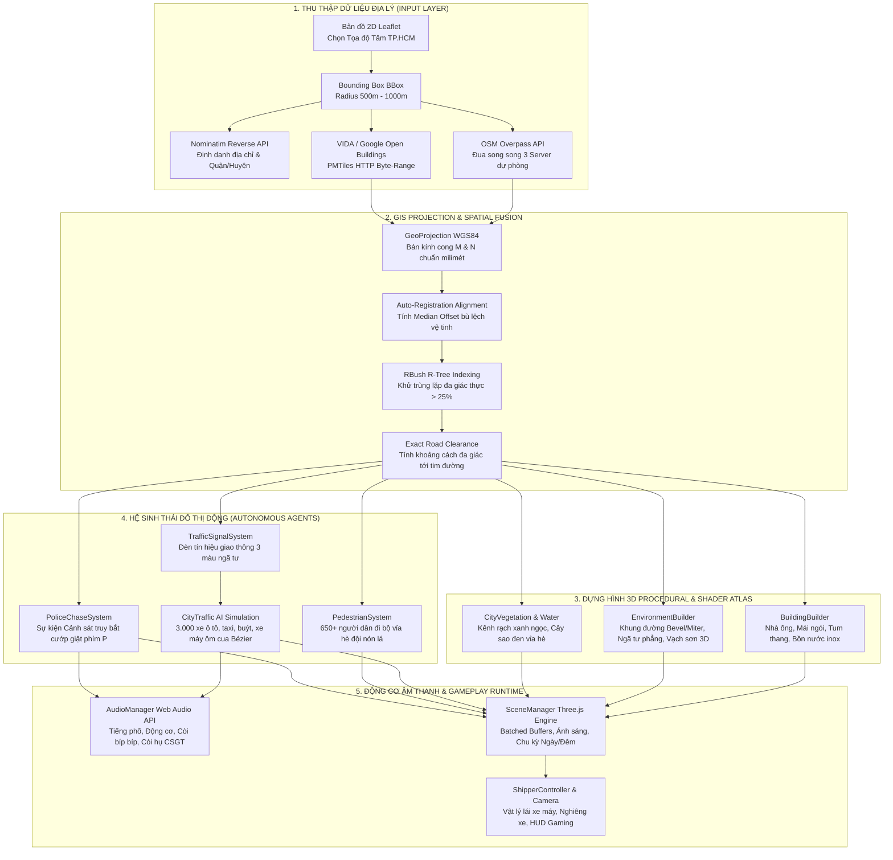

# 🛵 Saigon Shipper 3D RPG | 3D GIS Digital Twin City Generator

<p align="center">
  
</p>

<p align="center">
  <strong>Hệ thống tái tạo thế giới 3D đô thị Sài Gòn thời gian thực (Procedural 3D City Generator) theo tỉ lệ 1:1 mét từ dữ liệu bản đồ OpenStreetMap & AI Satellite Open Buildings, tích hợp cơ chế nhập vai Lái xe máy Giao hàng (Shipper RPG), mô phỏng giao thông AI 3.000 xe, đám đông đi bộ nón lá, sự kiện Cảnh sát rượt đuổi bắt cướp và động cơ âm thanh Web Audio API tự sinh.</strong>
</p>

<p align="center">
  
  
  
  
  
  
</p>

---

## 📑 Mục lục
- [1. Giới thiệu tổng quan](#1-giới-thiệu-tổng-quan)
- [2. Tính năng & Đột phá Kỹ thuật](#2-tính-năng--đột-phá-kỹ-thuật)
  - [2.1. Phép chiếu Trắc địa WGS84 chuẩn Milimét](#21-phép-chiếu-trắc-địa-wgs84-chuẩn-milimét)
  - [2.2. Tự động Căn chỉnh Vệ tinh & Khử trùng lặp Đa giác thực](#22-tự-động-căn-chỉnh-vệ-tinh--khử-trùng-lặp-đa-giác-thực)
  - [2.3. Kiến trúc Nhà Phố Sài Gòn Đậm Chất Bản Địa](#23-kiến-trúc-nhà-phố-sài-gòn-đậm-chất-bản-địa)
  - [2.4. Mạng lưới Giao thông Liền mạch Miter/Bevel & Vạch kẻ đường 3D](#24-mạng-lưới-giao-thông-liền-mạch-miterbevel--vạch-kẻ-đường-3d)
  - [2.5. Hệ thống Cột Đèn Tín hiệu Giao thông Ngã tư 3 Pha](#25-hệ-thống-cột-đèn-tín-hiệu-giao-thông-ngã-tư-3-pha)
  - [2.6. Mô phỏng Luồng Giao thông Đô thị AI 3.000 Xe](#26-mô-phỏng-luồng-giao-thông-đô-thị-ai-3000-xe)
  - [2.7. Quần thể 650+ Người dân Đi bộ Đội Nón Lá trên Vỉa hè](#27-quần-thể-650-người-dân-đi-bộ-đội-nón-lá-trên-vỉa-hè)
  - [2.8. Sự kiện Cảnh sát CSGT Truy bắt Cướp giật Tốc độ cao](#28-sự-kiện-cảnh-sát-csgt-truy-bắt-cướp-giật-tốc-độ-cao)
  - [2.9. Động cơ Âm thanh Tự sinh 100% Web Audio API](#29-động-cơ-âm-thanh-tự-sinh-100-web-audio-api)
  - [2.10. Trải nghiệm Nhập vai Shipper Lái Xe Máy & HUD Gaming](#210-trải-nghiệm-nhập-vai-shipper-lái-xe-máy--hud-gaming)
- [3. Sơ đồ Kiến trúc Toàn diện (System Pipeline)](#3-sơ-đồ-kiến-trúc-toàn-diện-system-pipeline)
- [4. Cấu trúc Thư mục Dự án](#4-cấu-trúc-thư-mục-dự-án)
- [5. Bảng Phím tắt & Hướng dẫn Điều khiển](#5-bảng-phím-tắt--hướng-dẫn-điều-khiển)
- [6. Hướng dẫn Cài đặt & Khởi chạy](#6-hướng-dẫn-cài-đặt--khởi-chạy)
- [7. Ngăn xếp Công nghệ](#7-ngăn-xếp-công-nghệ)

---

## 1. Giới thiệu tổng quan

**Saigon Shipper 3D** là nền tảng số hóa đô thị WebGL/Three.js thế hệ mới, kết hợp chặt chẽ giữa **Khoa học Thông tin Địa lý (GIS)**, **Kỹ thuật Đồ họa Trò chơi 3D Thủ tục (Procedural Generation)** và **Mô phỏng Đô thị Thời gian thực (Urban Simulation)**:

* **Tái tạo không gian đô thị tức thì:** Người dùng tự do chọn tọa độ bất kỳ tại TP. Hồ Chí Minh hoặc các đô thị Việt Nam trên Mini-map Leaflet 2D. Hệ thống tự động truy vấn vector từ **OpenStreetMap (Overpass API)** và mô hình AI trích xuất đáy nhà từ ảnh vệ tinh **Google / VIDA Open Buildings (PMTiles)** qua HTTP Range Requests.
* **Quy mô đô thị mở rộng:** Tái tạo khu vực rộng lớn từ $1.0\text{km} \times 1.0\text{km}$ lên đến $\sim 4.8\text{km}^2$ với hàng ngàn khối nhà, đại lộ, hẻm nhỏ ngoằn ngoèo, công viên rợp bóng cây sao đen và kênh rạch xanh ngọc.
* **Hệ sinh thái giao thông sống động:** Hơn **3.000 phương tiện tự hành (AI Traffic)** bao gồm xe buýt Sài Gòn, taxi, xe hơi, xe máy số/tay ga di chuyển đúng làn đường, tự động giảm tốc ôm cua và chấp hành đèn tín hiệu giao thông ngã tư.
* **Bản sắc văn hóa đường phố:** 650+ người dân đi bộ trên vỉa hè với nón lá truyền thống, tiếng còi xe máy *"bíp bíp"*, tiếng động cơ nổ giòn rã và sự kiện kịch tính: **Cảnh sát CSGT rượt đuổi tội phạm cướp giật** với đèn còi ưu tiên hú vang phố xá.
* **Không cần tải tài nguyên âm thanh ngoài:** Toàn bộ âm thanh phố thị, động cơ xe máy, còi xe, còi hụ cảnh sát được tổng hợp trực tiếp bằng thuật toán qua **Web Audio API** thời gian thực (Zero latency, Zero bandwidth).

---

## 2. Tính năng & Đột phá Kỹ thuật

### 2.1. Phép chiếu Trắc địa WGS84 chuẩn Milimét
Hệ thống sử dụng mô hình trắc địa Ellipsoid WGS84 thực nghiệm (`GeoProjection`), tính toán bán kính cong kinh tuyến $M$ và bán kính cong vòng thẳng đứng đầu $N$ tại vĩ độ tâm $\phi_0$:

$$M = \frac{a(1 - e^2)}{(1 - e^2 \sin^2\phi_0)^{3/2}}, \quad N = \frac{a}{\sqrt{1 - e^2 \sin^2\phi_0}}$$

$$x = (\text{lon} - \text{lon}_0) \times \frac{\pi}{180} \times N \cos\phi_0, \quad z = -(\text{lat} - \text{lat}_0) \times \frac{\pi}{180} \times M$$

* **Độ chính xác chuẩn xác đến milimét:** Triệt tiêu hoàn toàn sai số méo tỉ lệ (Projection Drift) giữa kinh tuyến và vĩ tuyến khi mở rộng quy mô hiển thị.
* **Đồng nhất không gian:** Tất cả các tầng dữ liệu (Nhà cửa, Đường sá, Vỉa hè, Mặt nước, Công viên, Cây xanh, Phương tiện) dùng chung gốc tọa độ `(0, 0, 0)` tương ứng $1\text{ đơn vị Three.js} = 1\text{ mét thực địa}$.

### 2.2. Tự động Căn chỉnh Vệ tinh & Khử trùng lặp Đa giác thực
Dữ liệu AI trích xuất từ ảnh vệ tinh chụp nghiêng (Off-Nadir) thường bị lệch tịnh tiến từ $1.0\text{m} - 3.5\text{m}$ so với bản đồ OSM.
* **Thuật toán Auto-Registration:** Tự động tìm kiếm các cặp tòa nhà đối ứng giữa OSM và VIDA có chỉ số $\text{IoU} \ge 0.35$.
* **Vector Dịch chuyển Trung vị (Median Offset):** Tính trung vị $(\Delta x, \Delta z)$ của tập mẫu để loại bỏ nhiễu biên (outliers), kéo toàn bộ lớp nhà vệ tinh khớp khít từng mét vào tim đường và mép vỉa hè OSM.
* **Khử trùng lặp bằng đa giác thực (Narrow-Phase Deduplication):** Sử dụng cấu trúc dữ liệu **RBush R-Tree 2D** kết hợp thuật toán kiểm tra đa giác thực (`isPointInPolygon`) với ngưỡng diện tích đè lên nhau $> 25\%$. Giữ lại vẹn nguyên các dãy nhà ống chung vách tường hoặc nằm trong góc khuyết của tòa nhà chữ L, chữ U.
* **Dọn dẹp tim đường chính xác (Exact Road Clearance):** Sử dụng khoảng cách thực từ đa giác nhà tới đoạn thẳng tim đường (`pointToSegmentDistance`), không sử dụng AABB thô kệch nhằm tránh xóa nhầm các căn nhà nằm sát đường chéo $45^\circ$.

### 2.3. Kiến trúc Nhà Phố Sài Gòn Đậm Chất Bản Địa
Mỗi khối nhà được phân tích typology để tái tạo văn hóa đô thị đặc trưng:
* **Nhà ống (Tube Houses):** Thuật toán phân tích hình học nhận diện 2 vách hông (Party Walls) tiếp giáp nhà hàng xóm để áp texture tường trát phẳng không có cửa sổ. Mặt tiền trước/sau trang bị ban công, cửa sổ kính và lan can.
* **Chuồng cu & Bồn nước Inox:** Nhà mái bằng tự động sinh tum thang (chuồng cu) và bồn nước inox sáng bóng hình trụ nằm ở góc sân thượng.
* **Mái ngói dốc & Tôn sóng:** Tỉ lệ 45% nhà phố sở hữu mái dốc ngói đất nung đỏ/cam hoặc tôn lạnh màu xanh chống nóng.
* **Giếng trời công trình lớn:** Các khối nhà chữ U, chữ O, trường học và bảo tàng có giếng trời (`relation[multipolygon]`) được đục rỗng chính xác bằng thuật toán `earcut` với vector pháp tuyến hướng vào lòng sân trong.
* **Texture Atlas Tối ưu:** Toàn bộ công trình trong thành phố gộp chung một Texture Atlas duy nhất được sinh tự động bằng mã HTML Canvas, đạt chỉ số Draw Calls tối thiểu.

### 2.4. Mạng lưới Giao thông Liền mạch Miter/Bevel & Vạch kẻ đường 3D
* **Không đĩa tròn, không Z-Fighting:** Thay thế các đĩa tròn thô kệch bằng giải thuật bo vát góc liên tục **Miter / Bevel Join** dọc theo tim đường.
* **Vá mặt phẳng ngã tư (Seamless Intersection Patches):** Tự động tạo đa giác convex lấp kín mọi giao lộ 3 ngã, 4 ngã và bùng binh, triệt tiêu mọi khe nứt hình học.
* **Hệ thống vạch kẻ đường 3D tách biệt:** Vạch tim đường đứt đoạn/liền, vạch dừng xe (Stop Lines), vạch đi bộ qua đường (Zebra Crossings) được đùn nổi ở độ cao tách biệt với thuộc tính `polygonOffset` khử triệt để hiện tượng nhấp nháy hình học.
* **Cầu vượt & Cầu bắc qua sông:** Nhận diện thuộc tính `bridge=yes` để tự động xây dựng dầm cầu bê tông, trụ cầu cắm xuống mặt nước và lan can bảo vệ (`elevation +3.8m .. +8.0m`).
* **Hàng cây xanh đại lộ & Công viên:** Cây sao đen tán rộng được rải tự động dọc theo vỉa hè các trục đường chính (cách xa giao lộ $\ge 22\text{m}$) và rải cụm trong công viên, tuyệt đối không mọc đè lòng đường hay rớt xuống sông.

### 2.5. Hệ thống Cột Đèn Tín hiệu Giao thông Ngã tư 3 Pha
Được hiện thực hóa trong module [`TrafficSignalSystem.ts`](file:///d:/map-3d/src/world/TrafficSignalSystem.ts):
* **Tự động nhận diện giao lộ đô thị:** Quét đồ thị giao thông (`roadGraph`) tìm các nút giao chính ngã 3, ngã 4 (bậc kết nối $\ge 3$ trên các tuyến đường chính, tự động loại trừ hẻm nhỏ và đường đi bộ).
* **Mô hình 3D cột thép tín hiệu:** Trụ thép cao 5.4m cắm trên vỉa hè ngoài mép bó vỉa hè, hộp đèn 3 màu Xanh - Vàng - Đỏ gắn đèn phát quang (Emissive).
* **Chu kỳ đèn thông minh:** Chu kỳ chuẩn 22 giây (10s Xanh $\to$ 3s Vàng $\to$ 9s Đỏ) với độ lệch pha ngẫu nhiên (phase offset) giữa các ngã tư trong thành phố.
* **Liên kết trực tiếp với AI xe:** Phương tiện giao thông tự động phát hiện đèn đỏ trước mặt để dừng trước vạch Stop Line và xuất phát khi đèn chuyển xanh.

### 2.6. Mô phỏng Luồng Giao thông Đô thị AI 3.000 Xe
Được quản lý bởi [`CityTraffic.ts`](file:///d:/map-3d/src/world/CityTraffic.ts) và [`VehicleModels.ts`](file:///d:/map-3d/src/world/VehicleModels.ts):
* **Đa dạng chủng loại phương tiện đặc trưng:**
  * **Xe buýt Sài Gòn (Saigon Bus):** Thân xe màu xanh lá - trắng đặc trưng, kính đen, bảng số tuyến LED.
  * **Xe taxi & Sedan:** Các mẫu xe hiện đại VinFast, Toyota, taxi Mai Linh xanh lá và Vinasun.
  * **Xe máy số & tay ga:** Honda Wave, Lead, SH, AirBlade do người dân điều khiển.
  * **Xe máy Shipper:** Thùng giữ nhiệt màu xanh lá/cam/đỏ phía sau yên.
* **Thuật toán điều hướng Quadratic Bézier Spline:** Khi rẽ tại ngã tư, phương tiện không bị xoay giật cục mà di chuyển theo đường cong Bézier bậc 2 mượt mà, tự động giảm tốc độ khi ôm cua.
* **Hệ thống Xi-nhan (Blinkers) thời gian thực:** Xe tự động kích hoạt đèn xi-nhan nhấp nháy màu hổ phách trước khi vào cua.
* **Tối ưu hóa 60 FPS:** 
  * Bảng tra cứu cạnh đồ thị $O(1)$ (`edgeMap`) loại bỏ 15 triệu phép quét mảng mỗi khung hình.
  * Gom nhóm `THREE.InstancedMesh` chia sẻ ma trận biến đổi (Thân xe, Chi tiết, Xi-nhan trái, Xi-nhan phải) giúp vẽ hàng ngàn xe chỉ với một vài Draw Calls.

### 2.7. Quần thể 650+ Người dân Đi bộ Đội Nón Lá trên Vỉa hè
Được quản lý bởi [`PedestrianSystem.ts`](file:///d:/map-3d/src/world/PedestrianSystem.ts):
* **Hơn 650 người đi bộ thời gian thực:** Di chuyển dọc theo vỉa hè của các trục phố lớn và hoa viên công viên.
* **Điểm nhấn văn hóa bản địa:** Mô hình low-poly tối ưu với trang phục màu sắc sống động và **Nón Lá Việt Nam** (truyền thống làm bằng lá cọ màu vàng nhạt) cùng mũ lưỡi trai năng động.
* **Chuyển động tự nhiên:** Mô phỏng nhịp bước chân (`walkPhase`), hướng nhìn tự xoay theo hướng di chuyển dọc mép đường.
* **Hiệu năng cao:** Toàn bộ quần thể được gộp thành các `InstancedMesh` với bảng màu Vertex Color, không gây sụt giảm khung hình.

### 2.8. Sự kiện Cảnh sát CSGT Truy bắt Cướp giật Tốc độ cao
Được xây dựng trong module [`PoliceChaseSystem.ts`](file:///d:/map-3d/src/world/PoliceChaseSystem.ts):
* **Kịch bản rượt đuổi nghẹt thở:**
  * **Đối tượng cướp giật:** Điều khiển *"xe cọp độ kiểng"* màu đỏ thể thao, pô độ, cúi rạp người phóng bạt mạng với tốc độ cao $\sim 70\text{ km/h}$.
  * **Mô tô Cảnh sát CSGT:** Xe đặc chủng phân khối lớn màu trắng kẻ sọc xanh, chiến sĩ CSGT mặc quân phục vàng cát đặc trưng rượt đuổi sát nút phía sau.
* **Đèn ưu tiên nhấp nháy khẩn cấp (Strobe Lights):** Đèn chớp xanh - đỏ luân phiên chiếu sáng mặt đường và các tòa nhà lân cận.
* **Còi hụ cảnh sát âm thanh 3D:** Tiếng còi hú *"ú o ú o..."* biến điệu tần số cao và còi rít *"Woop-woop!"* với độ lớn thay đổi tự nhiên theo khoảng cách đến camera/người chơi.
* **Kích hoạt linh hoạt:** 
  * Bấm phím tắt **`P`** hoặc nút **🚨 SỰ KIỆN TRUY BẮT** trên Sidebar.
  * Hệ thống tự động kích hoạt ngẫu nhiên một cuộc rượt đuổi trên phố mỗi 75 giây.
  * Hiển thị biểu ngữ cảnh báo khẩn cấp (Emergency Banner) trên giao diện HUD.

### 2.9. Động cơ Âm thanh Tự sinh 100% Web Audio API
Được phát triển độc lập trong [`AudioManager.ts`](file:///d:/map-3d/src/world/../services/AudioManager.ts):
* **Không phụ thuộc file ngoài:** Không cần bất kỳ file MP3/WAV/OGG nào. Hoạt động tức thì 100% trên mọi trình duyệt, không tốn dữ liệu tải về, không bị trễ.
* **Không gian âm thanh đô thị (Saigon Ambient Traffic):**
  * Âm thanh ma sát lốp xe và gió lùa trên mặt đường nhựa qua bộ lọc dải thông (Bandpass filter 480Hz).
  * Tiếng rền trầm lắng của dòng xe cộ từ xa qua dao động sóng tam giác và sóng sin.
  * Tiếng còi xe máy *"tin tin... bíp bíp!"* ngẫu nhiên vọng lại từ các ngã phố.
* **Âm thanh động cơ xe máy 4 thì của Shipper:**
  * Mô phỏng tiếng nổ buồng đốt với tần số cơ bản 85Hz (chạy garanti) vút lên 240Hz+ khi kéo ga.
  * Phản ứng tức thì theo thao tác ga (`W` / `↑`) và phanh hãm số (`Space` / `S`).
* **Còi xe máy song âm Việt Nam:** Phát âm thanh *"Bíp bíp!"* song âm thực thụ (440Hz + 540Hz) khi bấm phím **`H`** hoặc click nút còi trên màn hình.
* **Âm thanh rơ-le xi-nhan cơ học:** Tiếng gõ *"Tách - Tắc!"* giòn giã khi bật xi-nhan qua phím `Q` / `E` hoặc ôm cua `A` / `D`.
* **Còi hú cảnh sát biến điệu (Wailing Siren):** Bộ dao động LFO tần số 0.85Hz điều biến tần số từ 625Hz đến 975Hz kèm còi chích điện tốc độ cao.
* **Lưu trữ trạng thái:** Nút Bật/Tắt âm thanh tổng (Master Mute/Unmute) lưu tự động vào `localStorage`.

### 2.10. Trải nghiệm Nhập vai Shipper Lái Xe Máy & HUD Gaming
* **Mô hình xe tay ga Shipper 3D:** Đèn pha chiếu sáng ban đêm, gương chiếu hậu, biển số và thùng hàng giao trà sữa phía sau.
* **Vật lý điều khiển chân thực:** Khả năng tăng tốc mượt mà, hãm phanh tức thì, lùi xe và **nghiêng thân xe theo quán tính (Leaning Physics)** khi ôm cua gấp.
* **Camera bám đuổi năng động (Dynamic Third-Person Chase Cam):** Bám mượt mà theo đuôi xe, tự động xoay và bù đắp góc nhìn khi xe quẹo gắt.
* **Giao diện HUD thể thao:**
  * Đồng hồ tốc độ điện tử hiển thị chỉ số KM/H theo thời gian thực.
  * Nhãn địa chỉ tự động dò tìm tên con đường hiện tại đang chạy xe.
  * Cụm đèn xi-nhan ảo nhấp nháy đồng bộ trên màn hình.
  * Bảng điều khiển thu gọn linh hoạt với phím tắt **`Tab`** hoặc **`H`**.

---

## 3. Sơ đồ Kiến trúc Toàn diện (System Pipeline)



---

## 4. Cấu trúc Thư mục Dự án

```
d:/map-3d/
├── docs/
│   └── banner.jpg               # Banner minh họa chất lượng cao
├── public/
│   ├── banner.jpg               # Asset phục vụ giao diện web
│   ├── favicon.svg              # Icon trình duyệt
│   └── icons.svg                # Bộ icon SVG
├── src/
│   ├── config/
│   │   └── endpoints.ts         # Cấu hình Overpass, PMTiles, Preset & Bảng màu Sài Gòn
│   ├── services/
│   │   ├── AudioManager.ts      # Động cơ âm thanh tự sinh 100% Web Audio API
│   │   ├── nominatim.ts         # Dịch vụ định vị địa chỉ OSM Nominatim
│   │   ├── openBuildings.ts     # Đọc PMTiles Vector Tiles (Google/VIDA AI Footprints)
│   │   ├── overpass.ts          # Truy vấn Overpass QL & bóc tách multipolygon
│   │   └── spatialFusion.ts     # Bộ xử lý Auto-Registration, RBush R-Tree & lọc va chạm
│   ├── types/
│   │   └── gis.ts               # Định nghĩa kiểu dữ liệu GIS, Graph, BBox, Building, Telemetry
│   ├── world/
│   │   ├── projection.ts        # Phép chiếu Trắc địa Ellipsoid WGS84 chuẩn milimét
│   │   ├── TextureGenerator.ts  # Sinh Texture Atlas kiến trúc bằng HTML Canvas
│   │   ├── BuildingBuilder.ts   # Dựng hình 3D nhà ống, cao ốc, chuồng cu, giếng trời
│   │   ├── EnvironmentBuilder.ts# Mạng lưới giao thông Bevel, ngã tư phẳng, cầu vượt, vạch sơn
│   │   ├── CityVegetation.ts    # Hệ thống cây sao đen đại lộ và công viên
│   │   ├── TrafficSignalSystem.ts# Cột đèn tín hiệu giao thông ngã 3, ngã 4 ba pha
│   │   ├── VehicleModels.ts     # Thư viện mô hình 3D xe hơi, taxi, buýt, xe máy, xe CSGT
│   │   ├── CityTraffic.ts       # Mô phỏng 3.000 phương tiện AI ôm cua Bézier & dừng đèn đỏ
│   │   ├── PedestrianSystem.ts  # Quần thể 650+ người dân vỉa hè đội nón lá
│   │   ├── PoliceChaseSystem.ts # Hệ thống sự kiện Cảnh sát CSGT rượt đuổi bắt cướp
│   │   ├── SceneManager.ts      # Khởi tạo Three.js Scene, Render loop, Camera & Ánh sáng
│   │   └── ShipperController.ts # Bộ điều khiển xe máy Shipper, vật lý nghiêng xe & camera bám
│   ├── index.html               # Cấu trúc giao diện HUD Gaming, Mini-map & Banner cảnh báo
│   ├── main.ts                  # Bộ điều phối trung tâm (Pipeline Orchestrator)
│   └── style.css                # Giao diện Gaming Dark-mode Glassmorphism đẳng cấp
├── package.json                 # Cấu hình thư viện và scripts dự án
├── tsconfig.json                # Cấu hình TypeScript 6.0
└── vite.config.ts               # Cấu hình máy chủ Vite 8.3
```

---

## 5. Bảng Phím tắt & Hướng dẫn Điều khiển

| Phím / Thao tác | Chức năng trong Trò chơi & Mô phỏng |
| :--- | :--- |
| **W** hoặc **↑** | Tăng ga, phóng xe máy về phía trước |
| **S** hoặc **↓** | Hãm phanh / Lùi xe |
| **A** hoặc **←** | Bo cua sang trái (Tự động nghiêng người & bật xi-nhan trái) |
| **D** hoặc **→** | Bo cua sang phải (Tự động nghiêng người & bật xi-nhan phải) |
| **Q** | Bật / Tắt thủ công Xi-nhan Trái (Có âm thanh rơ-le cơ học) |
| **E** | Bật / Tắt thủ công Xi-nhan Phải (Có âm thanh rơ-le cơ học) |
| **Space** (Dấu cách) | Phanh gấp khẩn cấp |
| **H** hoặc **B** | Bấm còi xe máy *"Bíp bíp!"* song âm đặc trưng Việt Nam |
| **P** | **Kích hoạt / Tắt sự kiện Cảnh sát rượt đuổi bắt cướp giật (Police Chase)** |
| **Tab** *(hoặc H khi ở Orbit)* | Thu gọn / Mở rộng bảng điều khiển HUD bên trái |
| **R** | Đặt lại (Reset) vị trí xe máy Shipper về nút giao an toàn |
| **Shift** (Giữ) | Tăng tốc hỏa tốc Nitro |
| **Nút 🔊 / 🔇 trên HUD** | Bật / Tắt toàn bộ hệ thống âm thanh (Master Mute) |
| **Chuột trái (Kéo)** | Xoay góc nhìn tự do 360° (ở chế độ Orbit) |
| **Cuộn chuột** | Phóng to / Thu nhỏ thành phố |
| **Địa điểm Tiêu biểu** | Bấm chọn nhanh: Chợ Bến Thành, Hẻm Xóm Chiếu, Landmark 81, Chợ Lớn |
| **Mini-map 2D** | Click hoặc kéo con trỏ tới vị trí bất kỳ rồi bấm **🚀 DỰNG KHU NÀY** |

---

## 6. Hướng dẫn Cài đặt & Khởi chạy

### Yêu cầu hệ thống
* **Node.js**: Phiên bản 18.0.0 trở lên.
* **Trình duyệt**: Hỗ trợ WebGL 2.0 & Web Audio API (Google Chrome, Microsoft Edge, Brave, Firefox).

### Các bước cài đặt

1. **Clone repository và di chuyển vào thư mục dự án:**
   ```bash
   git clone https://github.com/dovanquy2005/map-3d.git
   cd map-3d
   ```

2. **Cài đặt các gói phụ thuộc:**
   ```bash
   npm install
   ```

3. **Khởi chạy môi trường phát triển (Dev Server):**
   ```bash
   npm run dev
   ```
   > 💡 **Mẹo trên Windows:** Nếu gặp lỗi hạn chế script PowerShell (`UnauthorizedAccess`), bạn hãy chạy bằng Command Prompt:
   > ```cmd
   > cmd.exe /c "npm run dev"
   > ```
   > hoặc cấp quyền tạm thời:
   > ```powershell
   > Set-ExecutionPolicy -Scope CurrentUser -ExecutionPolicy RemoteSigned
   > ```

4. **Trải nghiệm ứng dụng:**
   Mở trình duyệt và truy cập: **`http://localhost:5173`**

5. **Đóng gói phiên bản chính thức (Production Build):**
   ```bash
   npm run build
   ```

---

## 7. Ngăn xếp Công nghệ

* **Đồ họa & Dựng hình 3D:** [Three.js r186](https://threejs.org/) (WebGL 2.0), Canvas Procedural Texture Atlas, `InstancedMesh` Batching.
* **Âm thanh Tự sinh:** Web Audio API thuần túy (Oscillators, BiquadFilters, LFO Modulation, Noise Generators).
* **Ngôn ngữ & Công cụ:** [TypeScript 6.0](https://www.typescriptlang.org/), [Vite 8.3](https://vitejs.dev/).
* **Dữ liệu Địa lý & Không gian (GIS):**
  * [OpenStreetMap Overpass API](https://wiki.openstreetmap.org/wiki/Overpass_API) (Mạng lưới đường bộ, địa vật, công viên, sông ngòi).
  * [PMTiles (Protomaps)](https://protomaps.com/docs/pmtiles) + Google / VIDA Open Buildings (Hàng triệu footprint nhà trích xuất bằng AI).
  * [Nominatim](https://nominatim.org/) (Reverse Geocoding xác định tên đường và quận/huyện).
  * [@turf/turf](https://turfjs.org/) (Phân tích hình học không gian).
  * [RBush](https://github.com/mourner/rbush) (Chỉ mục không gian R-Tree 2D hiệu năng cao).
  * [Earcut](https://github.com/mapbox/earcut) (Tam giác hóa đa giác phức có lỗ khoét giếng trời).
  * [Leaflet.js](https://leafletjs.com/) (Bản đồ chọn tọa độ 2D tương tác).

---

<p align="center">
  Phát triển với ❤️ dành cho TP. Hồ Chí Minh — Đưa công nghệ Bản đồ Số 3D & Bản sắc Văn hóa Đường phố Việt Nam vươn tầm thế giới.
</p>
